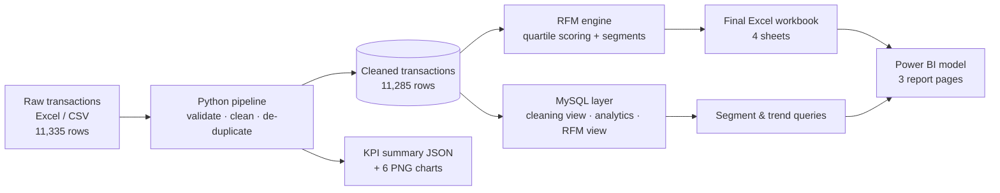
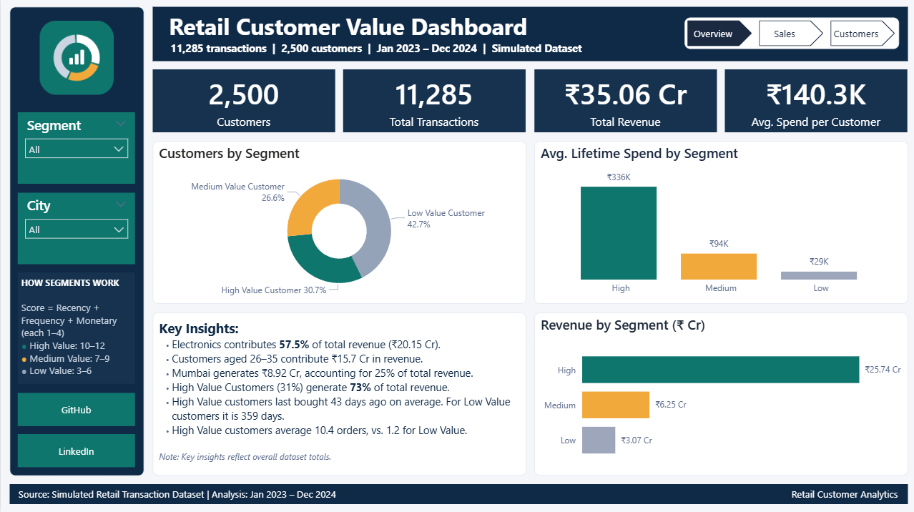
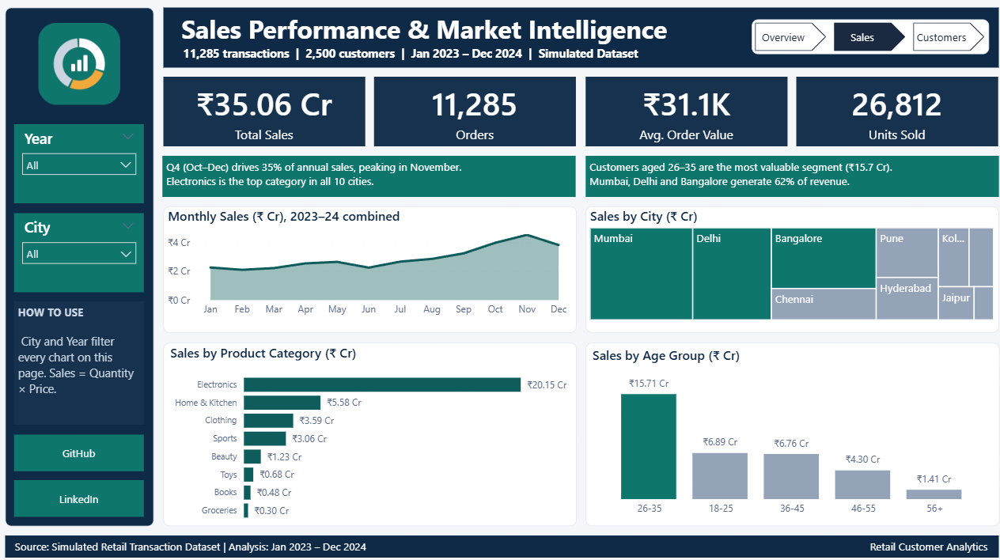
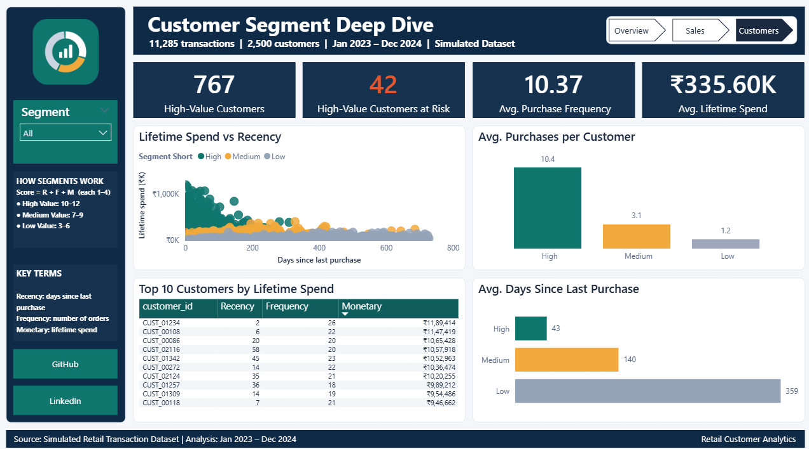

# Retail Customer Analytics & RFM Segmentation

> An end-to-end analytics project that cleans 11,335 raw retail transactions, segments 2,500 customers with RFM scoring, and delivers a three-page Power BI dashboard for revenue and customer-value decisions.


---

## Table of Contents

1. [Project Overview](#project-overview)
2. [Business Impact (Google XYZ)](#business-impact-google-xyz)
3. [System Architecture](#system-architecture)
4. [Repository Structure](#repository-structure)
5. [Data Dictionary](#data-dictionary)
6. [Data Quality Rules](#data-quality-rules)
7. [RFM Methodology](#rfm-methodology)
8. [Key SQL Query Snippets](#key-sql-query-snippets)
9. [Visual Metrics Breakdown](#visual-metrics-breakdown)
10. [Key Findings](#key-findings)
11. [Getting Started](#getting-started)
12. [Power BI Refresh Notes](#power-bi-refresh-notes)
13. [Tech Stack](#tech-stack)
14. [Limitations & Next Steps](#limitations--next-steps)
15. [Author](#author)

---

## Project Overview

A multi-city Indian retailer (simulated data) records every sale but has no consolidated view of **who its best customers are**, **where revenue comes from**, or **which customers are drifting away**. This project answers those questions.

| | |
|---|---|
| **Dataset** | 11,335 raw transaction records, 10 columns, 1 Jan 2023 – 31 Dec 2024 (after cleaning) |
| **Scope** | 10 cities, 8 product categories, 2,500 unique customers |
| **Cleaned output** | 11,285 validated transactions (INR 35.06 Cr total revenue) |
| **Method** | Data cleaning → exploratory analysis → RFM scoring → customer segmentation → Power BI dashboard |
| **Deliverables** | Re-runnable Python pipeline, MySQL analytics layer, 3-page Power BI report |

> **Data note:** the dataset is a simulated e-commerce dataset with intentionally injected quality issues (duplicates, nulls, casing variants, out-of-window dates). Findings demonstrate the method; they are not results from a real company.

**Business questions answered**

- Which cities and product categories drive revenue?
- How does revenue move month to month?
- Which customers are High, Medium and Low value, and how do they behave differently?
- Who are the top 100 customers, and which high-value customers are at risk of lapsing?

---

## Business Impact (Google XYZ)

> Format: **Accomplished [X], as measured by [Y], by doing [Z].**

- **Accomplished** a ranked, targetable view of the customer base, **as measured by** 767 High-Value customers (30.7% of 2,500) generating 73.4% of revenue, identified with an RFM score of 10–12, **by** building a quartile-based RFM scoring model in both Python and SQL.
- **Accomplished** clear visibility into revenue concentration, **as measured by** three cities (Mumbai, Delhi, Bangalore) contributing INR 21.77 Cr, or 62.1% of INR 35.06 Cr total revenue, **by** consolidating 11,285 validated transactions into city, category and monthly views.
- **Accomplished** analysis-ready data from a messy source, **as measured by** 45 duplicates and 5 out-of-window transactions removed, 90 missing totals recalculated and 263 missing ages imputed, all logged in an audit trail, **by** codifying the cleaning rules into an automated validation pipeline.
- **Accomplished** trustworthy recency scoring, **as measured by** average customer recency falling from 645 to 204 days (High-Value customers: 482 to 43 days), **by** excluding five transactions dated 14 months after the data window that had pushed the snapshot date forward.
- **Accomplished** repeatable reporting, **as measured by** a single-command run that regenerates the workbook, KPIs and all six charts, **by** replacing notebook cell-by-cell execution with a parameterised Python script.

---

## System Architecture



**Data flow**

1. **Ingest**: raw Excel/CSV is read and schema-validated.
2. **Clean**: text standardised, duplicates removed, invalid rows dropped, nulls imputed, totals reconciled.
3. **Analyse**: revenue by city, category, month, gender and age group.
4. **Score**: Recency, Frequency and Monetary values are scored 1–4 and summed to an RFM score (3–12).
5. **Segment**: High (10–12), Medium (7–9), Low (3–6).
6. **Publish**: four-sheet workbook feeds Power BI; the SQL layer reproduces the same logic for a database environment.

---

## Repository Structure

```text
retail-customer-analytics/
├── README.md
├── requirements.txt
├── .gitignore
├── src/
│   └── retail_customer_analysis.py      # end-to-end pipeline (CLI)
├── sql/
│   └── retail_customer_analytics.sql    # schema, cleaning view, analytics, RFM view
├── dashboard/
│   └── Retail_customer_project.pbix     # Power BI report (3 pages)
└── docs/
    ├── Retail_Customer_Analytics_Business_Report.docx
    ├── Retail_Customer_Analytics_Methodology_Report.docx
    └── images/                          # dashboard screenshots (3 PNGs)
```

> `data/` (raw dataset) and `outputs/` (generated workbook, KPIs, charts) are created locally when you run the pipeline and are git-ignored.

---

## Data Dictionary

### Source table: `Transactions` (one row per transaction)

| Column | Type | Description | Cleaning rule |
|---|---|---|---|
| `CustomerID` | text | Unique customer identifier, e.g. `CUST_00319` | Trimmed, upper-cased; rows with null dropped |
| `Gender` | text | `Male` or `Female` | Trimmed, title-cased, `M`/`F` mapped |
| `Age` | integer | Customer age in years | Outside 18–90 treated as invalid; nulls imputed with median |
| `City` | text | City of purchase (10 cities) | Trimmed, title-cased |
| `TransactionID` | text | Unique transaction identifier, e.g. `TXN_001397` | Trimmed, upper-cased; must be unique |
| `TransactionDate` | date | Purchase date | Parsed from `DD-Mon-YYYY`; unparseable rows dropped |
| `ProductCategory` | text | One of 8 categories | Trimmed, title-cased |
| `Quantity` | integer | Units purchased | Must be ≥ 1 |
| `Price` | decimal | Unit price in INR | Must be > 0 |
| `TotalAmount` | decimal | Line total in INR | Recalculated as `Quantity × Price` when null or inconsistent |

**Categories:** Electronics, Clothing, Home & Kitchen, Beauty, Sports, Books, Toys, Groceries
**Cities:** Mumbai, Delhi, Bangalore, Chennai, Pune, Hyderabad, Kolkata, Ahmedabad, Jaipur, Lucknow

### Derived table: `RFM_Analysis` (one row per customer)

| Column | Type | Description |
|---|---|---|
| `customer_id` | text | Customer identifier |
| `Recency` | integer | Days between the customer's last purchase and the snapshot date (last valid transaction date + 1 day, i.e. 29 Dec 2024) |
| `Frequency` | integer | Number of distinct transactions |
| `Monetary` | decimal | Total spend in INR |
| `R_score` | integer 1–4 | 4 = most recent purchasers |
| `F_score` | integer 1–4 | 4 = most frequent purchasers |
| `M_score` | integer 1–4 | 4 = highest spenders |
| `RFM_Score` | integer 3–12 | `R_score + F_score + M_score` |
| `Segment` | text | `High Value Customer`, `Medium Value Customer` or `Low Value Customer` |

The workbook also contains `Top_100_Customers` and `High_Value_Customers`, which share the `RFM_Analysis` schema.

---

## Data Quality Rules

| # | Rule | Records affected |
|---|---|---|
| 1 | Standardise text and identifiers before comparing rows | – |
| 2 | Drop rows missing a key or an unparseable date | 0 |
| 3 | Remove transactions dated after the observation window (31 Dec 2024); all five carry the date 15 Mar 2026 | 5 |
| 4 | Remove duplicate rows, then repeated `TransactionID` (keep first) | 45 |
| 5 | Remove invalid `Quantity` (< 1) or `Price` (≤ 0) | 0 |
| 6 | Age outside 18–90 → null, then median imputation (median 32) | 263 nulls imputed |
| 7 | Recalculate `TotalAmount = Quantity × Price` when null or off by > INR 0.01 | 90 nulls recalculated |
| 8 | Flag (not remove) extreme high-ticket transactions (IQR × 3 fence) | 332 flagged |
| 9 | Assert unique `TransactionID` and no nulls in key fields | pass |

Every run writes the counts for each rule to `outputs/kpi_summary.json`.

**Python and SQL use the same rules.** The SQL cleaning view applies them in the same order: the first row in file order is kept for a repeated `TransactionID`, invalid `Quantity` / `Price` rows are removed after de-duplication, and missing or blank Gender, City and ProductCategory become `Unknown`. The SQL RFM view reproduces pandas' quartile edges. Both were run on the same test data, and the cleaned rows and every customer's segment matched.

---

## RFM Methodology

| Dimension | Measure | Scoring (quartiles) |
|---|---|---|
| **Recency** | Days since last purchase (snapshot date 29 Dec 2024) | Lowest days = 4, highest = 1 |
| **Frequency** | Distinct transactions | Rank-based quartiles; highest = 4 |
| **Monetary** | Total spend (INR) | Highest = 4 |

| RFM score | Segment | Customers | Customer share | Revenue share | Avg recency (days) | Avg frequency |
|---|---|---|---|---|---|---|
| 10 – 12 | High Value Customer | 767 | 30.7% | 73.4% | 43 | 10.4 |
| 7 – 9 | Medium Value Customer | 665 | 26.6% | 17.8% | 140 | 3.1 |
| 3 – 6 | Low Value Customer | 1,068 | 42.7% | 8.8% | 359 | 1.2 |

Frequency uses `rank(method="first")` before bucketing because many customers tie on small purchase counts, which would otherwise create duplicate quartile edges.

---

## Key SQL Query Snippets

Full, runnable script: [`retail_customer_analytics_mysql.sql`](retail_customer_analytics_mysql.sql) (MySQL 8.0+).

**1. Revenue by city with share and cumulative share (window functions)**

```sql
WITH city_revenue AS (
    SELECT city, COUNT(*) AS transactions, SUM(total_amount) AS revenue
    FROM retail.vw_transactions_clean
    GROUP BY city
)
SELECT
    RANK() OVER (ORDER BY revenue DESC)                       AS revenue_rank,
    city,
    ROUND(revenue, 2)                                         AS revenue,
    ROUND(100.0 * revenue / SUM(revenue) OVER (), 2)          AS revenue_share_pct,
    ROUND(100.0 * SUM(revenue) OVER (ORDER BY revenue DESC, city
                                     ROWS BETWEEN UNBOUNDED PRECEDING AND CURRENT ROW)
                / SUM(revenue) OVER (), 2)                    AS cumulative_share_pct
FROM city_revenue
ORDER BY revenue_rank, city;
```

**2. Month-over-month growth and 3-month moving average (`LAG`)**

```sql
WITH monthly AS (
    SELECT DATE_SUB(transaction_date, INTERVAL DAYOFMONTH(transaction_date) - 1 DAY) AS month_start,
           SUM(total_amount) AS revenue
    FROM retail.vw_transactions_clean
    GROUP BY month_start
)
SELECT
    month_start,
    ROUND(revenue, 2) AS revenue,
    ROUND(100.0 * (revenue - LAG(revenue) OVER w) / NULLIF(LAG(revenue) OVER w, 0), 2) AS mom_growth_pct,
    ROUND(AVG(revenue) OVER (ORDER BY month_start ROWS BETWEEN 2 PRECEDING AND CURRENT ROW), 2) AS revenue_3m_moving_avg
FROM monthly
WINDOW w AS (ORDER BY month_start)
ORDER BY month_start;
```

**3. RFM scoring that matches pandas (`pd.qcut`)**

MySQL has no `PERCENTILE_CONT`, so the quartile edges are calculated from `ROW_NUMBER` with the same linear interpolation pandas uses. Tied values stay in one bucket.

```sql
-- Rank every customer by recency, then pick the rows around each quartile position
SELECT recency AS v,
       ROW_NUMBER() OVER (ORDER BY recency) AS rn,
       COUNT(*) OVER ()                     AS n
FROM customer_metrics;

-- Edge for the 25th percentile = value_lo + fraction * (value_hi - value_lo)
--   position = 1 + 0.25 * (n - 1);  lo = FLOOR(position);  hi = CEIL(position)

-- Recency score: fewer days since last purchase = higher score
CASE WHEN recency <= r_q1 THEN 4
     WHEN recency <= r_q2 THEN 3
     WHEN recency <= r_q3 THEN 2
     ELSE 1 END AS r_score
```

**4. High-value customers at risk of lapsing**

```sql
SELECT customer_id, recency, frequency, monetary, rfm_score
FROM retail.vw_rfm_analysis
WHERE segment = 'High Value Customer'
  AND r_score <= 2
ORDER BY monetary DESC;
```

The script also covers de-duplication with `ROW_NUMBER()`, median age imputation, age-band analysis, and preferred category per high-value customer.

---

## Visual Metrics Breakdown

The Power BI report (`dashboard/Retail_customer_project.pbix`) has three pages. Screenshots are stored in `docs/images/`.

### Page 1: Overview

KPI cards (customers, transactions, revenue, average spend per customer), customer distribution by segment, average lifetime spend by segment, revenue by segment, key insights, and Segment and City slicers.



### Page 2: Sales Performance & Market Intelligence

KPI cards (total sales, orders, average order value, units sold), monthly sales trend, sales by city (treemap), sales by product category, and sales by age group, filtered with Year and City slicers.



### Page 3: Customer Segment Deep Dive

High-value KPIs (767 customers, 42 at risk of lapsing, average purchase frequency, average lifetime spend), a lifetime-spend vs recency scatter by segment, average purchases and average days since last purchase by segment, and the top 10 customers by lifetime spend.



### Python-generated charts

| Chart | File |
|---|---|
| Revenue by city | `outputs/figures/01_revenue_by_city.png` |
| Revenue share by category | `outputs/figures/02_revenue_by_category.png` |
| Monthly revenue trend | `outputs/figures/03_monthly_revenue_trend.png` |
| Gender-wise spending | `outputs/figures/04_gender_spending.png` |
| Customers by segment | `outputs/figures/05_customers_by_segment.png` |
| Recency vs Monetary | `outputs/figures/06_recency_vs_monetary.png` |

---

## Key Findings

| Area | Finding |
|---|---|
| **Revenue** | INR 35.06 Cr across 11,285 transactions and 2,500 customers |
| **Geography** | Mumbai (INR 8.92 Cr, 25.4%), Delhi (INR 6.84 Cr) and Bangalore (INR 6.01 Cr) together account for 62.1% of revenue |
| **Category volume** | Electronics earns 57.5% of revenue (INR 20.15 Cr) and has the most transactions (2,486); Clothing sells the most units (6,865) |
| **Customers** | 30.7% of customers are High Value and generate 73.4% of revenue; 42.7% are Low Value and generate 8.8% |
| **Retention** | 42 High-Value customers (5.5% of that segment) have an RFM Recency score of 2 or lower and are candidates for win-back campaigns |
| **Demographics** | Average customer age is 34.3; the 26–35 age group contributes the most revenue (INR 15.7 Cr); male customers account for 6,103 transactions vs 5,182 for female |

**Recommendations**

1. Protect the top three cities with loyalty and retention programmes; test growth campaigns in Chennai and Pune.
2. Run win-back campaigns for the High-Value customers flagged as at-risk (SQL section 11).
3. Cross-sell using each High-Value customer's preferred category (SQL section 12).
4. Use Electronics for acquisition and Clothing for volume-led promotions.

---

## Getting Started

**Prerequisites:** Python 3.10+, and optionally MySQL 8.0+ and Power BI Desktop.

```bash
git clone https://github.com/nivedhasree-g/retail-customer-analytics.git
cd retail-customer-analytics

python -m venv .venv
source .venv/bin/activate          # Windows: .venv\Scripts\activate
pip install -r requirements.txt
```

**Run the pipeline**

```bash
python src/retail_customer_analysis.py \
    --input data/Retail_Customer_Dataset.xlsx \
    --output-dir outputs
```

| Option | Default | Purpose |
|---|---|---|
| `--input` | `data/Retail_Customer_Dataset.xlsx` | Raw `.xlsx` or `.csv` file |
| `--sheet` | `Raw_Dataset` (falls back to first sheet) | Excel sheet name or index |
| `--output-dir` | `outputs` | Where the workbook, KPIs and charts are written |
| `--max-valid-date` | `2024-12-31` | Rows dated later are removed (`none` disables) |
| `--snapshot-date` | last valid transaction date + 1 day | Fixed RFM reference date (`YYYY-MM-DD`) for reproducible scoring |
| `--no-charts` | off | Skip chart generation |

**Run the SQL layer (MySQL 8.0+)**

```bash
mysql -u <user> -p < retail_customer_analytics_mysql.sql
```

Or open `retail_customer_analytics_mysql.sql` in MySQL Workbench and run it section by section. Section 0 creates the `retail` database, the raw table and a `title_case()` helper. Load the raw CSV into `retail.transactions_raw` with the `LOAD DATA` example in the script (or Workbench's Table Data Import Wizard) before running the analysis queries.

---

## Power BI Refresh Notes

- The report reads `Retail_Customer_Final_Output_Dataset.xlsx`. In Power BI Desktop use **Transform data → Data source settings** to point it at your local `outputs/` copy.
- Keep the **Transactions** table at transaction level. Do not add a *Remove Duplicates* step on `CustomerID`, because that collapses it to one row per customer and understates every revenue visual.
- Re-import `RFM_Analysis`, `Top_100_Customers` and `High_Value_Customers` from the generated workbook. `Monetary` must equal the sum of `TotalAmount` per customer (not the sum of unit `Price`).
- Sheet and column names in the workbook are unchanged from the original model, so a refresh needs no remapping.

---

## Tech Stack

| Layer | Tools |
|---|---|
| Data processing | Python, pandas, NumPy |
| Visualisation | matplotlib, Power BI (DAX, data modelling, drill-through) |
| Database | MySQL 8 (CTEs, window functions, views) |
| Output | Excel (openpyxl) |

---

## Limitations & Next Steps

- RFM scores are relative quartiles, so segments always split the base in a fixed proportion; absolute thresholds would suit tracking over time.
- Gender is limited to two values in the source data.
- Possible extensions: K-Means clustering to compare with RFM, churn prediction, customer lifetime value, and scheduled refresh through a database-backed Power BI model.

---

## Author

**Nivedhasree Gajendrababu**
[LinkedIn](https://www.linkedin.com/in/nivedhasree-gajendrababu)
